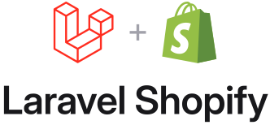
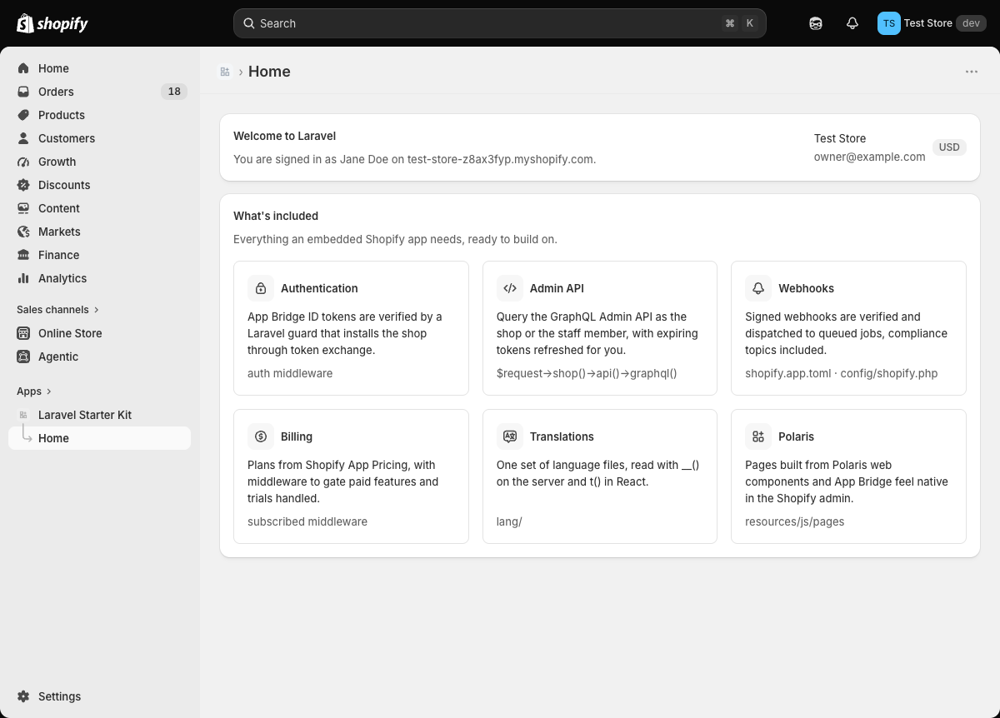

<p align="center">
  <picture>
    <source media="(prefers-color-scheme: dark)" srcset=".github/art/logo-dark.svg">
    
  </picture>
</p>

<p align="center">
  <a href="https://github.com/portside-labs/laravel-shopify/actions/workflows/tests.yml"></a>
  <a href="https://packagist.org/packages/portside-labs/laravel-shopify"></a>
  <a href="LICENSE"></a>
</p>

## About Laravel Shopify

A starter kit for building embedded Shopify apps the Laravel way: Laravel, Inertia, and React, with pages built from Shopify's Polaris web components so they feel native in the admin.

<p align="center">
  
</p>

## What's included

- **Authentication as a Laravel guard.** App Bridge ID tokens are verified on every request. `$request->user()` is the staff member, `$request->shop()` is their store, and routes are protected with `auth`.
- **Managed installation and token exchange.** No OAuth redirects. Offline tokens (the shop) and online tokens (the staff member) are exchanged, stored, and refreshed automatically, and a revoked token makes the app reinstall itself.
- **Webhooks as queued jobs.** Deliveries are verified and dispatched by topic. The compliance topics, `app/uninstalled`, and `app/scopes_update` are set up.
- **Polaris and App Bridge.** The admin's sidebar, loading bar, and toasts are wired to Inertia.
- **Translations.** One set of files in `lang/`, read with `__()` on the server and `t()` in React.
- **Billing through Shopify App Pricing.** A `subscribed` middleware and a Cashier-like API on `Shop`.
- **Artisan commands** to link the app, check its configuration, generate webhook jobs, and send test webhooks.
- **Tests, static analysis, and formatting** for all of the above.

## Requirements

- PHP 8.3+, Composer, and Node.js 22+
- [Shopify CLI](https://shopify.dev/docs/api/shopify-cli)
- A [Dev Dashboard](https://dev.shopify.com/dashboard) account and a development store
- For billing: a [Partner Dashboard](https://partners.shopify.com) account, where Shopify App Pricing plans are set up

## Getting started

```bash
composer create-project portside-labs/laravel-shopify my-app
cd my-app
```

1. Link a Shopify app and pull its credentials into `.env`:

    ```bash
    php artisan shopify:install
    ```

    The Shopify CLI lets you pick an app or create a new one. Locally, this links `shopify.app.dev.toml`, which git ignores, and sets `SHOPIFY_APP_CONFIG=dev` in `.env`, leaving `shopify.app.toml` for production. The kit's webhook subscriptions and settings are kept, and your app's client ID, name, URLs, and scopes are filled in.

2. Start the app:

    ```bash
    php artisan shopify:dev
    ```

    This installs the Node packages and runs `shopify app dev`, which opens a free Cloudflare tunnel (no account needed), starts the server, queue worker, and Vite, applies `shopify.app.dev.toml` to your development store, and installs the app there. Press `p` to open it. `APP_URL` in `.env`, and `application_url` and `redirect_urls` in `shopify.app.dev.toml`, follow the tunnel's URL. To use your own tunnel instead, pass it with `--tunnel-url=https://my-app.ngrok.dev` and forward it to `localhost:3000`, or add another port to the URL.

Change your access scopes or webhooks in `shopify.app.dev.toml`; `shopify:dev` applies them as it runs. Billing needs its own setup before the `subscribed` middleware works; see [Billing](#billing).

## Artisan commands

| Command                              | What it does                                                                                                                                                                                                                                                                                     |
| ------------------------------------ | ------------------------------------------------------------------------------------------------------------------------------------------------------------------------------------------------------------------------------------------------------------------------------------------------ |
| `shopify:install`                    | Links the app and writes its credentials to `.env`. Locally, it links `shopify.app.dev.toml`.                                                                                                                                                                                                    |
| `shopify:dev`                        | Serves the app through a tunnel and points `APP_URL` and the app's URLs in `shopify.app.toml` at it. Local environment only. Use `--tunnel-url` for your own tunnel.                                                                                                                             |
| `shopify:deploy`                     | Checks the configuration and releases it with `shopify app deploy`. `--production` deploys `shopify.app.toml`, `--config=staging` a named one, and `--env=production` reads `.env.production`. Passes on `--message`, `--app-version`, `--no-release`, `--allow-updates`, and `--allow-deletes`. |
| `shopify:doctor`                     | Checks credentials, URLs, API version, webhooks, and billing settings. Fails on errors, so it can run in CI.                                                                                                                                                                                     |
| `make:shopify-webhook orders/create` | Creates the job and a test, maps the topic in `config/shopify.php`, and subscribes to it in `shopify.app.toml`.                                                                                                                                                                                  |
| `shopify:webhook orders/create`      | Sends a signed webhook to the app in-process, with no tunnel needed. Use `--sync` to run the job immediately and `--payload=file.json` to send your own payload.                                                                                                                                 |

## Using the kit

### Admin API

```php
$request->shop()->api()->graphql('{ shop { name } }')->json('data.shop');
```

`Shop::api()` acts as the shop. `User::api()` acts as the staff member, limited to their permissions. Both use Laravel's HTTP client, so `Http::fake()` works in tests.

### Webhooks

Every webhook goes to `/webhooks` and is dispatched to the job mapped to its topic in `config/shopify.php`. Add one with `php artisan make:shopify-webhook {topic}`, then run `php artisan shopify:deploy`. Jobs receive the `Shop` and the payload.

### Translations

Put every string in `lang/` and read it with `__()` or `t()`, using Laravel's `:placeholder` and `singular|plural` syntax on both sides:

```tsx
const { t } = useTranslation();

t('home.welcome', { app: name });
t('orders.count', { count: 3 }); // "{0} No orders|{1} One order|[2,*] :count orders"
```

The staff member's admin language is picked up from Shopify. To add a language, translate `lang/{locale}` and add the locale to `app.locales` in `config/app.php`.

### Billing

Plans are sold through [Shopify App Pricing](https://shopify.dev/docs/apps/launch/billing/shopify-app-pricing), so billing works once the app is set up for it:

1. In the Partner Dashboard, switch the app's pricing to Shopify App Pricing and create its plans. Set each plan's welcome link to `/billing/welcome`.
2. Create a [Partner API client](https://shopify.dev/docs/api/partner#create-a-partner-api-client) with the "Manage apps" permission.
3. Add the app and the client to `.env`. The handle is the part of the app's admin URL after `/apps/`, the app ID is shown in the Partner Dashboard, and the organization ID is the number in the dashboard's URL:

    ```dotenv
    SHOPIFY_APP_HANDLE=my-app
    SHOPIFY_APP_ID=1234
    SHOPIFY_PARTNER_ORGANIZATION_ID=12345
    SHOPIFY_PARTNER_ACCESS_TOKEN=prtapi_...
    ```

`php artisan shopify:doctor` notes any of these that are missing.

Gate routes with `subscribed`, or `subscribed:pro` for a specific plan:

```php
Route::get('/reports', ReportController::class)->middleware('subscribed');
```

Shops without a plan are sent to Shopify's plan selection page. Check plans in code with:

```php
$shop->subscribed();          // any active plan
$shop->subscribed('pro');     // a specific plan
$shop->onTrial();
$shop->subscription()?->plan;
$shop->subscription()?->pendingPlan; // a move Shopify has scheduled for the end of the billing cycle
```

Shopify sends no webhook when a subscription changes, so the plan is cached for five minutes. After a plan change, the welcome link holds the merchant on the pricing page until the Partner API shows the plan they chose. Development stores can take any plan for free.

### Building pages

- Add pages to `resources/js/pages`, built from Polaris web components. Link to routes with Wayfinder (`resources/js/routes`).
- Register routes in `routes/web.php` behind `auth`.
- Authorize with policies using `$user->account_owner`, `$user->collaborator`, and `$user->scopes`.
- Show a toast from any controller with `Inertia::flash('toast', 'Saved.')`.
- Listen for `App\Events\ShopInstalled` and `ShopUninstalled` for onboarding and cleanup.
- Run `composer test` (Pint, PHPStan, tests) and `npm run check` (frontend lint and format).

## Deploying

- Serve over HTTPS and run a queue worker.
- Set `APP_URL`, `SHOPIFY_API_KEY`, `SHOPIFY_API_SECRET`, and the billing variables if you sell plans.
- Link your production app to `shopify.app.toml` with `php artisan shopify:install --env=production`, which reads and writes `.env.production`. Point its `application_url` and `redirect_urls` at your domain, and run `php artisan shopify:deploy --production --env=production`. It refuses to deploy while the URL is still a tunnel or a placeholder.
- Run `php artisan shopify:doctor` to catch misconfiguration. It also warns when `SHOPIFY_API_VERSION` is nearing the end of support.

## Working with AI agents

`CLAUDE.md` describes the kit's conventions for Claude Code. `.mcp.json` registers the Shopify Dev MCP server, and Laravel Boost adds Laravel tooling.

## License

MIT. See [LICENSE](LICENSE).
